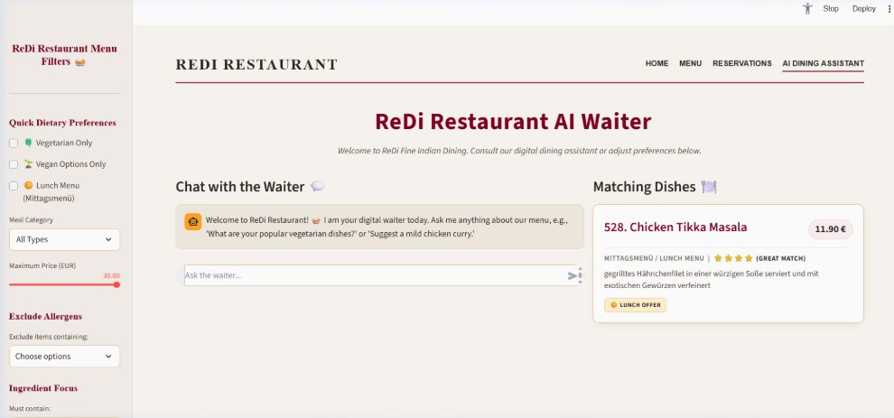
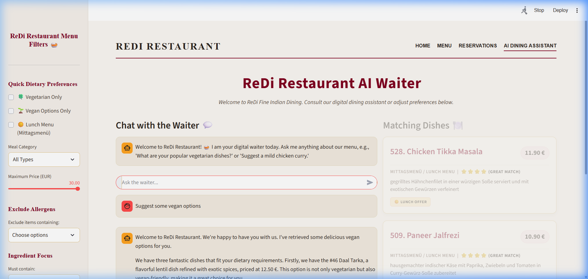
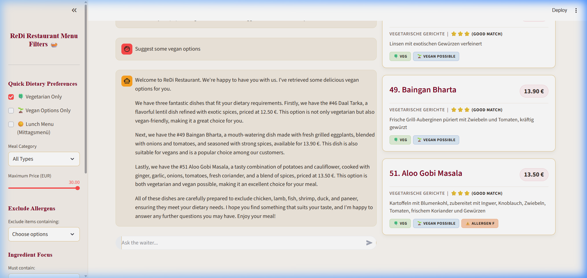
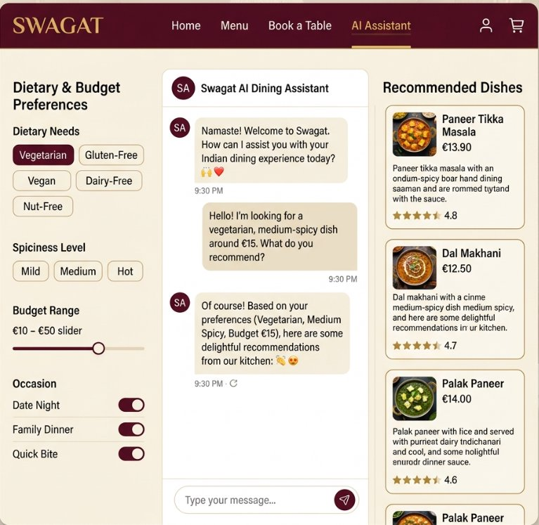
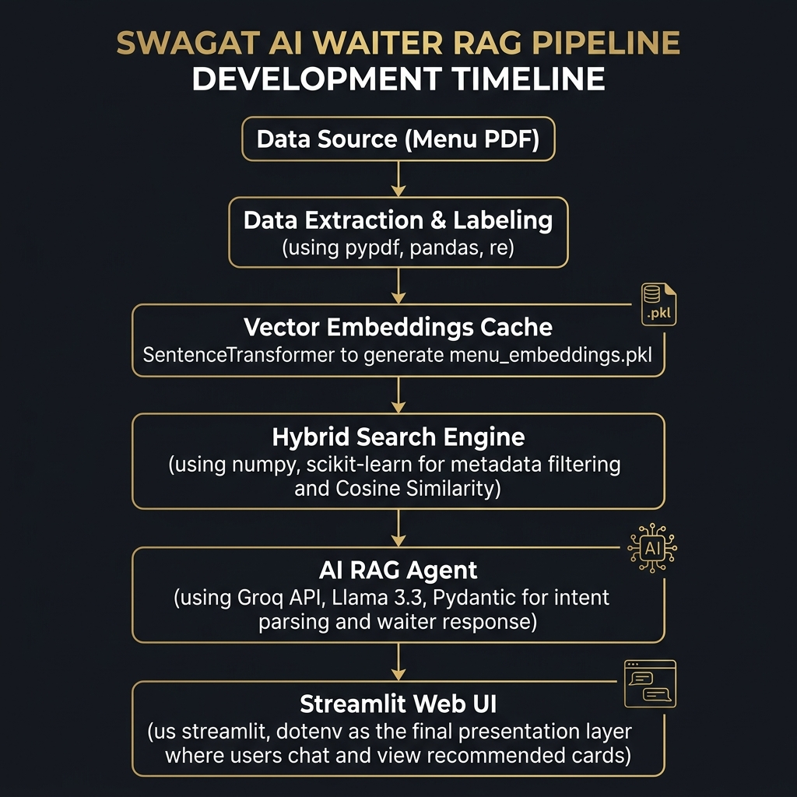

# 🍛 ReDi Restaurant AI Waiter

An intelligent, allergy-safe menu recommendation chatbot for **ReDi Restaurant** built with **Retrieval-Augmented Generation (RAG)**, **Hybrid Vector Search**, and **Groq LLM**.

[](https://restaurant-ai-waiter.streamlit.app/)
[](https://github.com/Bright579523/restaurant-ai-waiter)
[](https://www.python.org/downloads/)
[](https://opensource.org/licenses/MIT)

> 🚀 **Live Demo Available:** Try out the chatbot live at **[restaurant-ai-waiter.streamlit.app](https://restaurant-ai-waiter.streamlit.app/)**

---

## 🌟 Highlights & Key Features

- **🛡️ Allergy-Safe & Dietary Aware**: Two-tier allergen detection (strict letter-code matching + keyword checking for dairy, nuts, gluten, etc.). Supports Vegetarian and Vegan options with zero guesswork.
- **💰 Budget-Conscious Filtering**: Precise numeric price filtering combined with semantic intent parsing.
- **🧠 Hybrid Vector Retrieval**: Combines SQL-like Boolean metadata filtering (Pandas/NumPy) with Cosine Similarity semantic ranking (`paraphrase-multilingual-MiniLM-L12-v2`).
- **🌐 Multilingual Intelligence**: Converses naturally in English, German, and Thai, translating German dish descriptions dynamically.
- **⚡ Ultra-Fast Inference**: Powered by the Groq LPU engine for instant real-time waiter responses.
- **📊 Interactive Streamlit UI**: Chat history, quick example questions, catalog filtering, and embedded original menu PDF viewer.

---

## 📸 Application Showcase

### 🏠 1. Luxury Restaurant AI Waiter Interface
> *Intuitive two-column landing interface featuring live sidebar dietary/allergen filters, conversational AI waiter chat, and real-time matching dish recommendation cards.*


*Caption: Live application view — ReDi Restaurant AI Waiter with quick dietary preferences, allergen exclusion, budget slider, chat dialog, and matching dish cards.*

<br/>

### 💬 2. Interactive AI Waiter Dialog (RAG in Action)
> *Customers can ask in natural language. The system parses intent, queries the menu database, and generates conversational recommendations.*


*Caption: Real-time conversation showing dish recommendations, prices, ingredients, and allergen warnings.*

<br/>

### 📋 3. Menu Explorer & Dynamic Catalog Filtering
> *Dedicated tab for browsing all 157 dishes with interactive filters by category, dietary preferences, and price slider.*


*Caption: Interactive menu explorer allowing users to filter dishes by budget, category, and vegan/vegetarian flags.*

<br/>

### 🎨 4. Design Mockup Concept
> *UI/UX concept layout for the next-generation digital restaurant portal.*


*Caption: High-fidelity visual mockup of the restaurant ordering experience.*

---

## 🏗️ System Architecture

```text
User Natural Language Query
          │
          ▼
┌────────────────────────────────────────┐
│  1. Intent Parsing (Groq LLM)          │
│  - Extracts semantic search query      │
│  - Extracts structured Pydantic filter │
│    (price, dietary, allergens, meal)   │
└──────────────────┬─────────────────────┘
                   │
                   ▼
┌────────────────────────────────────────┐
│  2. Hybrid Retrieval Engine            │
│  - Step 1: Boolean Metadata Filter     │
│  - Step 2: Cosine Similarity Ranking   │
│            (SentenceTransformers)      │
└──────────────────┬─────────────────────┘
                   │
                   ▼
┌────────────────────────────────────────┐
│  3. Response Generation (Groq RAG)     │
│  - Grounds answers in menu items       │
│  - Explains allergens & dietary safety │
│  - Matches user language automatically │
└──────────────────┬─────────────────────┘
                   │
                   ▼
       Streamlit Chat Interface
```


*Caption: Detailed pipeline showing PDF extraction, structured CSV transformation, vector caching, and RAG execution flow.*

---

## 📁 Repository Structure

```text
restaurant-ai-waiter/
├── raw_data/                         # Original restaurant menu document
│   └── Menu of ReDi Restaurant.pdf 
├── data_pipeline/                    # Extraction & cleaning scripts
│   ├── extract_text.py               # PDF text extractor
│   ├── extracted_menu.txt            # Raw extracted text
│   ├── generate_csv.py               # Structured CSV parser & allergen tagger
│   └── verify_csv.py                 # Dataset verification script
├── data_output/                      # Final structured dataset
│   └── redi_menu.csv                 # 157 dishes with full metadata tags
├── embeddings/                       # Vector cache builder
│   ├── build_embeddings.py           # Encodes search_text column
│   └── menu_embeddings.pkl           # Precomputed vector cache
├── search_engine/                    # Hybrid retrieval engine
│   └── search_engine.py              # Boolean mask + Cosine Similarity ranker
├── agent/                            # Conversational RAG agent
│   └── agent.py                      # Intent parser, retrieval & answer generator
├── app/                              # Streamlit application
│   └── app.py                        # Multi-tab web application
├── app.py                            # Root Streamlit entrypoint
├── report/                           # Architecture diagrams and documentation
│   ├── project_summary.md
│   ├── system_architecture.png
│   ├── dashboard_home.png
│   ├── dashboard_chatting.png
│   ├── dashboard_filtered.png
│   └── redi_ui_mockup.jpg
├── requirements.txt                  # Python dependencies
├── .env.example                      # Template for environment variables
└── README.md
```

---

## 🛠️ Tech Stack

| Category | Technology | Purpose |
|---|---|---|
| **Programming Language** | Python 3.10+ | Core language for backend logic and RAG pipeline |
| **PDF Extraction** | `pypdf` | Extracts German text from the original 12-page menu PDF |
| **Data Processing & Filtering** | `pandas`, `numpy` | Structured tabular data manipulation and boolean filtering |
| **Text Embedding Model** | `paraphrase-multilingual-MiniLM-L12-v2` (`sentence-transformers`) | Computes 384-dimensional multilingual sentence embeddings |
| **Vector Similarity** | `scikit-learn` (Cosine Similarity) | Calculates semantic relevance scores between query and dishes |
| **Data Serialization** | `pickle` | Serializes DataFrame and embedding matrix for instant startup |
| **Intent Schema Validation** | `Pydantic v2` | Enforces structured JSON output schema for user intent |
| **LLM Inference** | Groq API (`qwen/qwen3.8-27b`) | Natural language generation and intent parsing at ultra-low latency |
| **Web UI Framework** | `streamlit` | Interactive web dashboard and real-time chat interface |
| **Cloud Hosting** | Streamlit Community Cloud | Continuous deployment from GitHub repository |

---

## 🚀 Quick Start Guide

### 1. Clone the repository
```bash
git clone https://github.com/Bright579523/restaurant-ai-waiter.git
cd restaurant-ai-waiter
```

### 2. Install dependencies
```bash
pip install -r requirements.txt
```

### 3. Configure API Key
Create a `.env` file in the project root:
```bash
cp .env.example .env
```
Add your free Groq API key:
```env
GROQ_API_KEY=gsk_your_groq_api_key_here
```

### 4. (Optional) Rebuild Vector Cache
If you update the menu CSV, rebuild the vector cache:
```bash
python embeddings/build_embeddings.py
```

### 5. Launch the Streamlit App
```bash
streamlit run app.py
```
Open your browser at `http://localhost:8501` or visit the live deployment at **[restaurant-ai-waiter.streamlit.app](https://restaurant-ai-waiter.streamlit.app/)**.

---

## 👨‍💻 Author

**Watcharapon Anaketanaset (Bright)**  
ReDi School of Digital Integration — Final Project 2026  
- **GitHub:** [@Bright579523](https://github.com/Bright579523)  
- **Live Project:** [restaurant-ai-waiter.streamlit.app](https://restaurant-ai-waiter.streamlit.app/)
